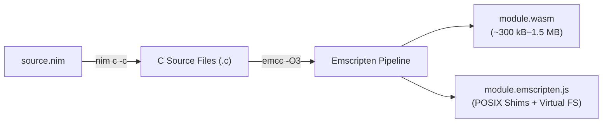

# Emscripten Runtime Backend

The **Emscripten Runtime Backend** (`--backend:emscripten`) compiles your Nim code into WebAssembly using the official Emscripten SDK (`emcc`). It generates both a WebAssembly binary (`.wasm`) and a companion modularized ES6 JavaScript runtime (`.emscripten.js`), providing a full POSIX-compatible environment with an in-memory virtual filesystem.

---

## Architecture Overview



Unlike the standalone backend which generates bare WebAssembly for direct browser instantiation, Emscripten wraps the binary in an ES6 module factory (`createModule()`) that wires up POSIX system calls, memory allocation hooks, and an in-memory filesystem.

---

## Toolchain & Command-Line Arguments

When you invoke `nimts compile synth.nim synth.wasm --backend:emscripten` (or set `nimtsPlugin({ backend: 'emscripten' })` in Vite), NimTS runs a two-stage compilation:

### Stage 1: Nim Code Generation (`nim c -c`)

Nim compiles the module into intermediate C files inside `.nimcache/`:

```bash
nim c -c \
  -d:emscripten \
  -d:release \
  --opt:speed \
  --cpu:wasm32 \
  -p:"<nimts_src>" \
  --nimcache:"<nimcache_dir>" \
  "synth.nim"
```

#### Flag Rationale:
| Flag | Purpose |
| :--- | :--- |
| `-c` | Generates C source files without calling the host compiler. |
| `-d:emscripten` | Activates Nim's built-in Emscripten target profiles and standard library configurations. |
| `-d:release --opt:speed` | Enables release optimizations. |
| `--cpu:wasm32` | Targets 32-bit WebAssembly architecture. |

### Stage 2: Emscripten Compilation & Linking (`emcc`)

`emcc` compiles the generated C files, bundles standard library shims, and outputs a modularized ES6 JavaScript loader and `.wasm` binary:

```bash
emcc -O3 \
  -sEXPORT_ALL=1 \
  -sMODULARIZE=1 \
  -sEXPORT_ES6=1 \
  -sALLOW_MEMORY_GROWTH=1 \
  -sFORCE_FILESYSTEM=1 \
  -I"${NIM_LIB}" \
  -o "synth.emscripten.js" \
  "${NIMCACHE_DIR}"/*.c
```

#### Flag Rationale:
| Flag | Purpose |
| :--- | :--- |
| `-O3` | Enables Emscripten's highest optimization level, running binaryen optimizer passes (`wasm-opt`) to shrink code size and improve execution speed. |
| `-sEXPORT_ALL=1` | Exports all C-ABI procedures generated by `{.exportts.}` to the WebAssembly export table so they are callable from JavaScript. |
| `-sMODULARIZE=1` | Packages the Emscripten runtime inside an asynchronous factory function (`createModule()`) rather than attaching properties to the global `window` or `globalThis` object. |
| `-sEXPORT_ES6=1` | Emits standard ES module syntax (`export default createModule;`) compatible with Vite, Webpack, and modern Node.js. |
| `-sALLOW_MEMORY_GROWTH=1` | Enables WebAssembly linear memory growth beyond the initial page allocation when requested by the application. |
| `-sFORCE_FILESYSTEM=1` | Bundles Emscripten's in-memory virtual filesystem (`FS`), allowing standard C file operations (`fopen`, `fread`, `fwrite`, `stat`) to work transparently in browser memory. |

---

## What is Included vs. Excluded

| Feature | Status | Details |
| :--- | :---: | :--- |
| **Virtual Filesystem (`FS`)** | **Included** | In-memory POSIX filesystem emulator. Allows code using standard file I/O to read and write virtual files in browser RAM. |
| **Full POSIX Shims** | **Included** | Emulates POSIX clocks, errno, environment variables, and standard C library behaviors. |
| **ES6 Factory Loader** | **Included** | Generates an asynchronous `createModule()` factory that handles runtime bootstrap. |
| **Preloaded / Embedded Data** | **Supported** | Can bundle external assets directly into the virtual filesystem via Emscripten's `--preload-file` flag. |
| **Ultra-Small Binary Size** | **Excluded** | The Emscripten runtime and filesystem layers add **300 kB to 1.5+ MB** of code depending on included features. |
| **AudioWorklet Isolation** | **Excluded** | Not recommended for `AudioWorkletGlobalScope` due to DOM/browser assumptions in the Emscripten JS glue. |

---

## When to Choose Emscripten?

### 1. Legacy C/C++ Dependencies with File I/O
If your Nim codebase wraps a third-party C library (e.g. SQLite, libgit2, audio decoders, image processing libraries, or game engines) that calls `fopen`, `fread`, or standard POSIX file descriptor APIs, Emscripten is the ideal choice. Its virtual filesystem (`FS`) lets those libraries read and write files as if running on a real desktop OS.

### 2. Full POSIX Standard Library Coverage
When your Nim code relies on POSIX system features that are not provided by basic WASI sysroot, Emscripten provides comprehensive emulation layers.

---

## How to Use

### Prerequisites
To use the Emscripten backend, you must have the Emscripten SDK (`emsdk`) installed and available in your environment:

```bash
# macOS via Homebrew:
brew install emscripten

# Or via official Emscripten SDK:
git clone https://github.com/emscripten-core/emsdk.git
./emsdk/emsdk install latest
./emsdk/emsdk activate latest
source ./emsdk/emsdk_env.sh
```

### Via Standalone CLI
```bash
nimts compile src/synth.nim dist/synth.wasm --backend:emscripten
```

This produces:
- `dist/synth.wasm`: WebAssembly binary.
- `dist/synth.emscripten.js`: Modularized ES6 Emscripten runtime.

### Via Vite Plugin
```typescript
// vite.config.ts
import { defineConfig } from 'vite';
import { nimtsPlugin } from '@axiomantic/nimts/vite';

export default defineConfig({
  plugins: [
    nimtsPlugin({
      backend: 'emscripten'
    })
  ]
});
```

---

## Official Documentation & Reference Resources

- [Official Emscripten Documentation](https://emscripten.org/): Comprehensive guide to the Emscripten compiler and toolchain.
- [Emscripten Settings Reference (`src/settings.js`)](https://github.com/emscripten-core/emscripten/blob/main/src/settings.js): Full documentation of all `-s` compiler flags and options.
- [Emscripten File System API (`FS`)](https://emscripten.org/docs/api_reference/Filesystem-API.html): How to mount, read, and write files in Emscripten's virtual filesystem.
- [Nim Compiler Emscripten Guide](https://nim-lang.org/docs/nimc.html#crossmincompilation-for-emscripten): Official Nim documentation on cross-compiling Nim code to WebAssembly via Emscripten.
