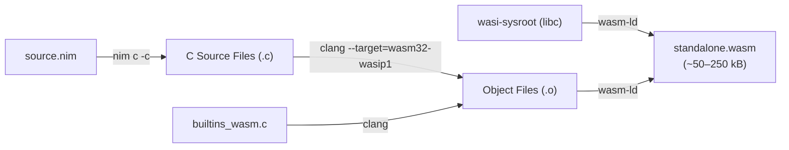

# Standalone Micro-WASM Backend (Default)

The **Standalone Micro-WASM Backend** is NimTS's default compilation target. It compiles your Nim code into pure, lean WebAssembly using LLVM Clang, `wasm-ld`, and `wasi-sysroot`, without requiring Emscripten or any external JavaScript runtime glue.

---

## Architecture Overview



The standalone pipeline produces a minimal WebAssembly binary that communicates directly with the lightweight `@axiomantic/nimts/runtime` loader via standard browser APIs (`WebAssembly.instantiate` / `WebAssembly.instantiateStreaming`).

---

## Toolchain & Command-Line Arguments

When you invoke `nimts compile synth.nim synth.wasm` (or use `nimtsPlugin({ backend: 'standalone' })` in Vite), NimTS runs a three-stage toolchain pipeline:

### Stage 1: Nim Code Generation (`nim c -c`)

Nim compiles your high-level Nim code into intermediate C source files inside a dedicated `.nimcache/` directory:

```bash
nim c -c \
  -d:emscripten \
  -d:useMalloc \
  -d:release \
  --opt:speed \
  --cpu:wasm32 \
  --noMain:on \
  -p:"<nimts_src>" \
  --nimcache:"<nimcache_dir>" \
  "synth.nim"
```

#### Flag Rationale:
| Flag | Purpose |
| :--- | :--- |
| `-c` | Compiles to intermediate C code only; does not invoke the host C compiler. |
| `-d:emscripten` | Configures Nim's internal target profiles for 32-bit WebAssembly integer/pointer widths and calling conventions. |
| `-d:useMalloc` | Directs Nim's memory subsystem to route heap allocations through standard C `malloc` and `free`, cleanly integrating with the WASI libc allocator and preventing redundant thread-local heap overhead. |
| `-d:release --opt:speed` | Enables whole-program release optimizations and aggressive loop unrolling. |
| `--cpu:wasm32` | Enforces 32-bit pointers and registers conforming to the Wasm32 specification. |
| `--noMain:on` | Suppresses the generation of a mandatory C `main()` function, allowing the module to act as a pure WebAssembly library with exported function entries. |

### Stage 2: Clang Object Compilation (`clang`)

Clang compiles `builtins_wasm.c` and the generated Nim C sources into WebAssembly object files (`.o`):

```bash
clang --target=wasm32-wasip1 \
  --sysroot="${WASI_SYSROOT}" \
  -D_WASI_EMULATED_MMAN \
  -D_WASI_EMULATED_SIGNAL \
  -O3 -flto -mbulk-memory \
  -I"${NIM_LIB}" \
  -c -o "synth.o" "synth.c"
```

#### Flag Rationale:
| Flag | Purpose |
| :--- | :--- |
| `--target=wasm32-wasip1` | Generates 32-bit WebAssembly object code conforming to the WASI Preview 1 ABI. |
| `--sysroot="${WASI_SYSROOT}"` | Provides the minimal C standard library headers and precompiled libraries from `wasi-sysroot`. |
| `-mbulk-memory` | Emits hardware-accelerated WebAssembly bulk memory instructions (`memory.copy`, `memory.fill`) for maximum buffer throughput. |
| `-flto` | Enables LLVM Link-Time Optimization, allowing cross-file inlining and dead-code elimination across C sources. |
| `-D_WASI_EMULATED_MMAN` | Enables POSIX memory mapping emulation for dynamic heap expansion. |

### Stage 3: WebAssembly Linking (`wasm-ld`)

The LLVM WebAssembly linker combines all compiled object files and the WASI sysroot into the final `.wasm` binary:

```bash
wasm-ld \
  --no-entry \
  --export-all \
  --allow-undefined \
  --lto-O3 \
  --initial-memory=16777216 \
  --max-memory=2147483648 \
  --export=NimMain \
  --export=nimts_init \
  -L"${WASI_SYSROOT}/lib/wasm32-wasip1" \
  -lc -lwasi-emulated-mman -lwasi-emulated-signal \
  -o "synth.wasm" \
  *.o
```

#### Flag Rationale:
| Flag | Purpose |
| :--- | :--- |
| `--no-entry` | Declares that the binary is a library module with no `_start` or `main` entrypoint. |
| `--export-all` | Exports all C-ABI procedures annotated with `{.exportts.}` or `{.exportc.}` to the WebAssembly exports table. |
| `--export=NimMain` | Exports Nim's runtime initialization routine so global variables and GC can be initialized deterministically. |
| `--export=nimts_init` | Exports NimTS's idempotent runtime initializer. |
| `--initial-memory=16777216` | Pre-allocates 16 MB of initial WASM linear memory (256 Wasm pages), eliminating allocation pauses during initial startup. |
| `--max-memory=2147483648` | Caps maximum dynamic memory growth at 2 GB (the 32-bit WebAssembly ceiling). |

---

## What is Included vs. Excluded

| Feature | Status | Details |
| :--- | :---: | :--- |
| **WASI libc (`libc.a`)** | Included | Minimal standard C library (`malloc`, `free`, `memcpy`, `math.h`). |
| **Bulk Memory Operations** | Included | Fast native `memory.copy` and `memory.fill` opcodes. |
| **Dynamic Memory Growth** | Included | Scales dynamically from 16 MB to 2 GB as heap demands grow. |
| **WebGPU 256-Byte Alignment** | Included | Full support for `nimts_alloc_aligned` and `GpuBufferSlice[T]`. |
| **Emscripten JS Runtime** | **Excluded** | Zero Emscripten glue scripts (`emscripten.js`), zero global namespace pollution. |
| **Virtual Filesystem (`FS`)** | **Excluded** | No in-memory virtual filesystem layer. Code expecting disk `fopen` should use buffer passing or the Emscripten backend. |
| **POSIX Syscall Shims** | **Excluded** | No complex network socket or signal emulation. |

---

## Why Choose Standalone Micro-WASM?

### 1. Ultra-Compact Binary Footprint
Because there is no Emscripten runtime or filesystem emulator, typical NimTS modules compile to **50 kB to 250 kB** uncompressed (and even less under gzip/brotli).

### 2. AudioWorklet & Web Worker Hardened
In real-time audio threads (`AudioWorkletGlobalScope`), JavaScript code cannot access `window`, `document`, or `setTimeout`, and garbage collector pauses cause audible clicks and dropouts. The standalone WASM binary has zero DOM dependencies and loads instantly inside an AudioWorklet or Web Worker.

### 3. Instant Cold Starts
The binary is loaded directly using the browser's native `WebAssembly.instantiateStreaming(fetch('/wasm/synth.wasm'))`. There is no auxiliary JavaScript bootstrap file to parse or execute before WASM instantiation begins.

---

## How to Use

### Via Standalone CLI
```bash
# Default backend is standalone
nimts compile src/synth.nim dist/synth.wasm
```

### Via Vite Plugin
```typescript
// vite.config.ts
import { defineConfig } from 'vite';
import { nimtsPlugin } from '@axiomantic/nimts/vite';

export default defineConfig({
  plugins: [
    nimtsPlugin({
      backend: 'standalone' // default
    })
  ]
});
```

---

## Official Documentation & Reference Resources

- [Nim Compiler User Guide](https://nim-lang.org/docs/nimc.html): Official reference for Nim compilation flags, C code generation, and pragmas.
- [WebAssembly WASI SDK](https://github.com/WebAssembly/wasi-sdk): The standalone Clang/LLVM toolchain and libc sysroot distribution.
- [LLD WebAssembly Linker (`wasm-ld`)](https://lld.llvm.org/WebAssembly.html): Documentation for LLVM's WebAssembly linker flags and memory management.
- [WebAssembly Bulk Memory Proposal](https://github.com/WebAssembly/bulk-memory-operations): Specification for fast native memory operations.
