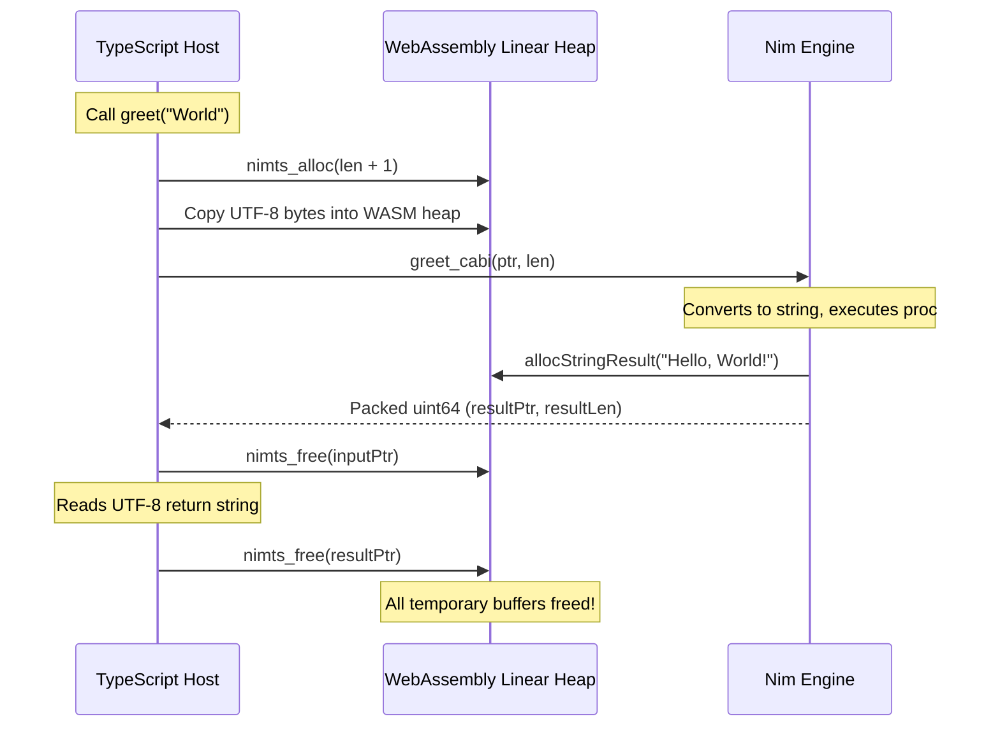
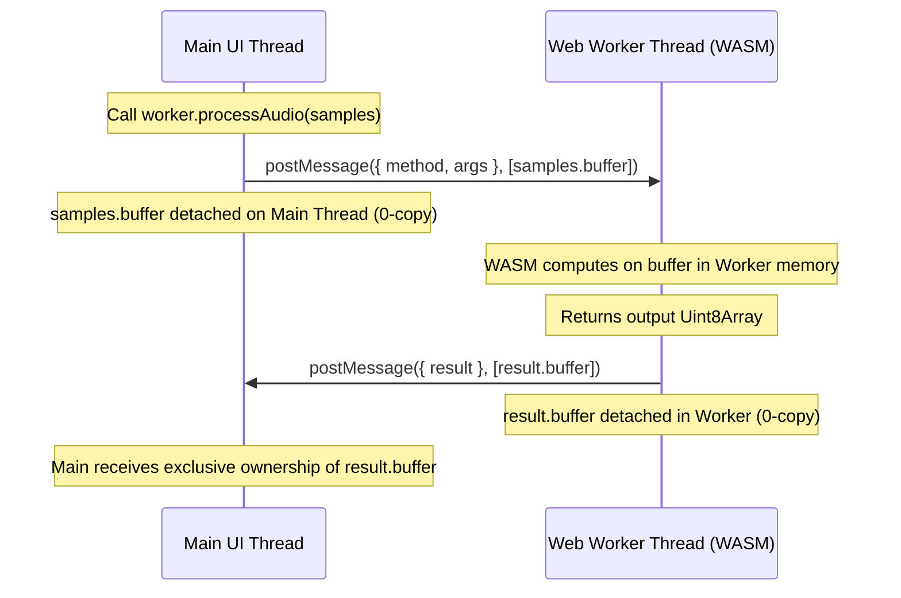

# Memory Management, Stateful Handles & Garbage Collection

WebAssembly runs in a sandboxed linear byte array (`WebAssembly.Memory`). Managing memory safely across the language boundary between Nim and JavaScript/TypeScript requires clear rules for allocation, lifetime tracking, and cross-thread transfers.

NimTS provides a zero-leak memory architecture built on top of Nim's deterministic ARC/ORC engine.

---

## 1. Nim's Memory Engine in WebAssembly: ARC / ORC

Modern Nim (Nim 2.0+) compiles by default with **ARC** (`--mm:arc`) or **ORC** (`--mm:orc`).


### No Stop-the-World GC Pauses
Unlike traditional garbage-collected languages (Java, Go, older Nim) or the JavaScript host engine, ARC does not run a background mark-and-sweep collector.
- **Deterministic Scope-Based Reclamation**: Memory reclamation is based on reference counting with compiler-injected move semantics and destructors (`=destroy`).
- **Immediate Free**: When a string, sequence, or object falls out of scope, its memory is freed immediately.
- **Predictable Real-Time Latency**: Audio synthesis (AudioWorklet), 60/120 FPS games, physics simulations, and WebGPU pipelines never suffer from unexpected GC stutter.
- **WASI Allocator Integration**: With `-d:useMalloc`, Nim routes all allocations through standard C `malloc` and `free` in `wasi-sysroot` (`dlmalloc`), cleanly sharing a single heap.

---

## 2. Ephemeral Call Lifecycle (Zero-Leak Calls)

For standard function calls passing primitives, strings, and byte arrays:



1. **Primitives (`int32`, `float32`, `bool`)**: Passed directly in WebAssembly CPU registers. Zero heap allocation.
2. **Input Strings & Buffers**: JavaScript allocates a temporary buffer in WASM memory via `nimts_alloc`. Nim reads the buffer, and the buffer is freed before or immediately after the call.
3. **Return Strings & `seq[byte]`**: Nim allocates the return buffer via `allocStringResult` or `allocBytesResult`, packing the pointer and byte length into a 64-bit register (`uint64`). The TypeScript wrapper copies the result into native JavaScript types and immediately invokes `nimts_free`.
4. **Leak Risk**: **0%**. All ephemeral memory is reclaimed synchronously within the call.

---

## 3. Stateful Handles (`ref object`)

Passing raw pointers of heap-allocated Nim data structures to JavaScript is unsafe: it exposes applications to use-after-free bugs, pointer corruption, and prevents Nim's ARC from tracking references.

NimTS solves this with **Opaque Stateful Handles**:

```nim
# src/synth.nim
type
  AudioEngine* {.exportts.} = ref object
    sampleRate*: float32
    volume*: float32

proc createEngine*(sampleRate: float32): AudioEngine {.exportts.} =
  AudioEngine(sampleRate: sampleRate, volume: 1.0'f32)

proc setVolume*(engine: AudioEngine, vol: float32) {.exportts.} =
  if engine != nil:
    engine.volume = vol
```

### How Handles Work
1. **Handle Allocation**: When `createEngine` returns an instance, NimTS assigns a monotonic 32-bit `HandleId`, registers the object in an internal handle table, and increments Nim's reference count via `GC_ref(obj)`.
2. **TypeScript Class Wrapper**: The generated TypeScript code exports a class wrapping the handle:
   ```typescript
   export class AudioEngine {
     readonly handleId: number;
     constructor(handleId: number);
     dispose(): void;
   }
   ```
3. **Handle ID Passing**: When `setVolume(engine, 0.707)` is called, the wrapper extracts `engine.handleId`. The WASM runtime looks up the `AudioEngine` pointer from the table with strict type safety.

### Deterministic Release (`.dispose()`)
For deterministic cleanup in performance-critical applications:

```typescript
const engine = createEngine(48000.0);
setVolume(engine, 0.707);

// Explicit immediate cleanup
engine.dispose();
```

When `.dispose()` is called:
- `nimts_destroy_handle(handleId)` is called in WebAssembly.
- Nim calls `GC_unref` on the tracked instance, allowing Nim's ARC/ORC to reclaim the memory immediately.
- The TypeScript wrapper zeroes out `handleId` to prevent use-after-free. Calling `.dispose()` multiple times is safe and idempotent.

### Automatic Fallback via `FinalizationRegistry`
If a developer forgets to call `.dispose()`, NimTS provides an automatic safety net:

The TypeScript runtime registers every active handle with JavaScript's native [`FinalizationRegistry`](https://developer.mozilla.org/en-US/docs/Web/JavaScript/Reference/Global_Objects/FinalizationRegistry). When the JavaScript garbage collector reclaims the JS wrapper object, the finalizer callback invokes `nimts_destroy_handle(handleId)` in the background, releasing the Nim memory.

---

## 4. Multi-Threaded Worker Memory: Bidirectional Zero-Copy Transfers

In `@axiomantic/nimts/worker` and Vite `?worker` mode, WebAssembly runs on a dedicated background OS thread.

To maximize throughput when processing large binary payloads (audio buffers, physics meshes, tensor batches), NimTS implements **bidirectional zero-copy buffer detachment**:



### How It Works:
1. **Main &rarr; Worker**: When you pass an `ArrayBuffer` or `TypedArray` to a worker method, `extractTransfers(args)` automatically identifies the underlying buffer and adds it to the `postMessage` transfer list. The caller's buffer is **detached / neutered** on the main thread and transferred to the worker in $O(1)$ time with zero byte copying.
2. **Worker &rarr; Main**: When the worker returns an `ArrayBuffer` or `TypedArray`, the worker runtime calls `extractTransfers(result)`. The buffer is detached in the worker thread and transferred back to the main thread Promise.
3. **Streaming &rarr; Main**: For channels or closure iterators streaming across a `MessagePort`, each emitted item is transferred with zero copy.

> [!TIP]
> If you need to retain a copy of the buffer on the sender thread instead of detaching it, pass `transferBuffers: false` in `spawnWorker` options:
> ```typescript
> const worker = await SynthWorker.spawn({ transferBuffers: false });
> ```

---

## 5. Memory Leak Risks & How to Prevent Them

We audited NimTS for common memory failure modes (verified by adversarial test suites `NEG-01` through `NEG-06`). Here are the real-world hazards and how NimTS handles them:

| Hazard | The Pitfall | How NimTS Handles It | Best Practice |
| :--- | :--- | :--- | :--- |
| **High-Churn Handles** | Creating millions of `ref object` instances without calling `.dispose()`. Relying solely on `FinalizationRegistry` can cause memory pressure because JS GC cycles run lazily. | Handled via fallback finalizers, but cannot force the host V8/browser GC to collect wrappers immediately. | Call `.dispose()` explicitly on `ref object` instances when finished (e.g. inside `finally` blocks). |
| **Cyclic References** | In pure `--mm:arc`, circular references between `ref object` instances (A &rarr; B &rarr; A) cannot be freed by reference counting alone. | Nim's `--mm:orc` adds a cyclic collector to ARC that tracks and reclaims cyclic graphs. | If your Nim data model uses circular parent/child pointer graphs, compile with `--mm:orc`. |
| **Abandoned Streams** | Breaking early out of a `for await (const chunk of channel)` loop without draining the channel. | Handled! When the loop breaks, the generator `.return()` method is called automatically, which closes the channel and releases handle table slots (verified by test `NEG-01`). | Use standard `for await...of` loops—early break is fully safe. |
| **Detached Buffer Trap** | When WebAssembly linear memory grows (`memory.grow`), the underlying `ArrayBuffer` is neutered. Existing typed array views throw a `TypeError`. | Handled! The NimTS runtime never caches raw `ArrayBuffer` references; accessors dynamically resolve `getMemory().buffer` on demand. | Use NimTS helpers (`readBytes`, `writeToGpuBuffer`) rather than saving long-lived references to `wasm.memory.buffer`. |
| **Channel Backpressure** | A producer thread pushes data faster than the consumer can process, causing unbounded memory growth. | Handled! `NimTsChannel[T]` has a fixed circular buffer capacity. When full, `trySend` rejects additional items, applying explicit backpressure rather than silently allocating memory. | Specify appropriate channel buffer capacities (e.g. `newChannel[string](32)`). |

---

## 6. Hardware Memory Alignment (WebGPU)

WebGPU dynamic uniform buffers require memory offsets aligned to 256 bytes (`minUniformBufferOffsetAlignment`). Standard `malloc` only guarantees 8- or 16-byte alignment.

NimTS provides hardware-aligned memory allocators in `src/nimts/memory.nim`:
- `nimts_alloc_aligned(size, 256)`: Allocates linear memory aligned to any power-of-two boundary using a prefix header storing the raw base pointer.
- `GpuBufferSlice[T]`: A typed wrapper that guarantees WebGPU alignment and provides zero-copy `device.queue.writeBuffer` transfers into GPU staging buffers.

For complete WebGPU compute examples, see the [WebGPU & GPU Compute Guide](./webgpu-compute.md).
